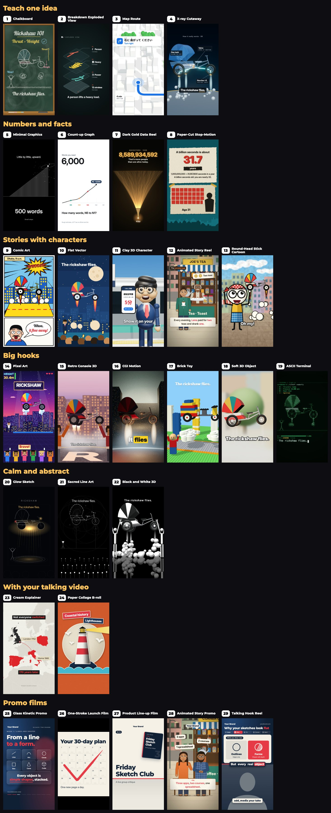

# anim-styles-mcp

An MCP server for short animated videos. Your AI client picks a look from 29, writes the page, and this server renders it to an MP4 with sound on your own machine. There are no API keys and nothing is uploaded.



You ask for something like "explain how vaccines work in the chalkboard look". The client reads that look's rules, starts from a working page, swaps in your subject, checks stills, renders, and hands you a 1080×1920 file. Text can be in any language: Latin, Bangla and Japanese fonts are bundled, and you can add others.

## Install

You need Node 20 or later and ffmpeg. Rendering uses Chrome if you have it. If you don't, the setup command below downloads a browser, about 150 MB.

**Claude Code**

```bash
claude mcp add anim-styles -- npx -y github:alomsoltanul/anim-styles-mcp
```

**Claude Desktop, Cursor and other clients**

```json
{
  "mcpServers": {
    "anim-styles": {
      "command": "npx",
      "args": ["-y", "github:alomsoltanul/anim-styles-mcp"]
    }
  }
}
```

Check the machine, and get the browser if it asks for one:

```bash
npx -y github:alomsoltanul/anim-styles-mcp doctor
```

```bash
npx -y github:alomsoltanul/anim-styles-mcp setup
```

Projects go in `~/anim-styles-projects`. Set `ANIM_HOME` in the server's `env` to move them.

Tested on macOS with Apple silicon. Linux and Windows have render settings in the code but have not been run yet, so please open an issue if something breaks.

## Using it

Say "show me the styles" and you get the numbered menu and picture sheet. Then reply with a number and a topic:

```
1: how vaccines work
```

Or name a look outright: "make a pixel art video about compound interest", "same topic in three looks", "make a promo for my course". The menu is grouped by what each look is good for, so you don't need to remember names.

## The looks

| # | Look | Good for |
|---|---|---|
| | **Teach one idea** | |
| 1 | Chalkboard | One rule or formula |
| 2 | Breakdown Exploded View | Anything with parts |
| 3 | Map Route | Journeys, directions, step by step |
| 4 | X-ray Cutaway | How a machine works |
| | **Numbers and facts** | |
| 5 | Minimal Graphics | Small steps adding up |
| 6 | Count-up Graph | A number growing |
| 7 | Dark Gold Data Reel | One huge fact about you |
| 8 | Paper-Cut Stop-Motion | Fact reels with rolling numbers |
| | **Stories with characters** | |
| 9 | Comic Art | Punchlines and reactions |
| 10 | Flat Vector | Clean cartoon, safe for long text |
| 11 | Clay 3D Character | A 3D person talking; needs a voice |
| 12 | Animated Story Reel | Narrated cartoon: lessons, satire |
| 13 | Round-Head Stick Cartoon | Quick "why" jokes |
| | **Big hooks** | |
| 14 | Pixel Art | Levels, scores, progress |
| 15 | Retro Console 3D | Funny, nostalgic stories |
| 16 | CGI Motion | "What if" hooks |
| 17 | Brick Toy | Things being built |
| 18 | Soft 3D Object | "What happens if" |
| 19 | ASCII Terminal | Tech and AI stories |
| | **Calm and abstract** | |
| 20 | Glow Sketch | A calm reveal of one object |
| 21 | Sacred Line Art | Ideas and mindset |
| 22 | Black and White 3D | One bold idea |
| | **With your talking video** | |
| 23 | Cream Explainer | Graphics between your talking clips |
| 24 | Paper Collage B-roll | Paper B-roll with labels |
| | **Promo films** | |
| 25 | Glass Kinetic Promo | Frosted panels and big type, on the beat |
| 26 | One-Stroke Launch Film | One product, 4:5 |
| 27 | Product Line-up Film | Several products in one film |
| 28 | Animated Story Promo | Two cartoon characters reach your product |
| 29 | Talking Hook Reel | Your face on camera, boards above |

## Promos

The promo looks read your brand from `brand.js`: name, colours, logo, products, call to action. Give these when you start, or edit the file later:

```json
{
  "name": "Acme Courses",
  "url": "acme.example",
  "cta": "Link in bio",
  "colors": { "bg": "#101F35", "ink": "#FBF7F2", "accent": "#E63946", "paper": "#F6F1E7" },
  "products": [{ "title": "Sketching in 30 Days", "sub": "30 short lessons" }]
}
```

Without a logo the name is drawn as a wordmark. Without a product image a card is drawn. Add your own files with `add_media`. A promo should show only true facts about your product, so check any number in it.

## Voice

No voice is included, because everyone wants a different one. Videos work with no voice at all. To add narration you have three choices, and you can mix them.

**A file per line.** Pass your own recording, or audio from any TTS tool your client can reach. This needs no setup and is the simplest way to use a voice from another MCP server.

**A command.** Set `ANIM_TTS_CMD` to anything that writes speech to a file. `{text}`, `{text_file}` and `{out}` are filled in. It runs without a shell.

```json
"env": { "ANIM_TTS_CMD": "my-tts --input {text_file} --output {out}" }
```

**An HTTP endpoint.** Set `ANIM_TTS_URL` to anything that speaks the OpenAI `/v1/audio/speech` format, local or hosted.

```json
"env": {
  "ANIM_TTS_URL": "http://localhost:8880/v1/audio/speech",
  "ANIM_TTS_MODEL": "your-model",
  "ANIM_TTS_VOICE": "your-voice",
  "ANIM_TTS_KEY": "only if it needs one"
}
```

Every line is levelled to the same loudness, so clips from different tools sit together. `add_voice` also writes `vo/timing.js` with line times and a mouth envelope, which is how the clay character's lips follow any voice. If you use a hosted voice, check that its licence covers what you publish.

## Tools

| Tool | What it does |
|---|---|
| `list_styles` | Numbered menu and picture sheet |
| `get_style` | A look's rules, what to keep and swap, and its target frame |
| `new_project` | Start from a look's working page |
| `read_file`, `write_file` | Edit project files, for clients with no file tools |
| `add_media` | Bring in your images, audio or video |
| `add_voice` | Add narration |
| `preview` | Local URL that plays the page live |
| `stills` | Render frames as one sheet |
| `render`, `render_status` | Video with motion blur and mixed sound |
| `check_video` | Size, length, loudness and frames from the finished file |
| `doctor` | Check ffmpeg, the browser and the voice setup |

A render that takes longer than about 40 seconds carries on as a job, so slow clips don't hit a client's tool timeout.

## How a page works

A project is a plain folder with a `page.html`. The page defines `prepare()`, which returns the length and sound cues, and `seek(t)`, which draws the frame for time `t` and nothing else. Because every frame depends only on `t`, frames can be rendered in any order and blended for motion blur. The full contract is in [cards/_rules.md](cards/_rules.md).

Sound is a soft air bed plus effects timed by the page. Every effect is synthesized by [tools/make-sfx.js](tools/make-sfx.js), so the repo holds no third-party audio. An optional `sound.json` sets loudness, adds a beat score, or brings in your own tracks.

## Adding a look

1. Make `styles/<id>/page.html`, using an existing look as a base.
2. Write `cards/<id>.md`: the rules that make it that look, and what to keep and swap.
3. Add it to the end of `catalog.json`, so older menu numbers stay put.
4. Save a frame as `gallery/<id>.jpg`, then run `npm run sheet` and `npm test`.

## Security

Pages run in a headless browser with the network blocked. They load only local files, from a server on 127.0.0.1 that refuses paths outside the project. File tools stay inside the project folder too. A TTS command or URL can only come from your own config, never from a tool call, so a prompt can't make the server run something. `add_media` and `add_voice` read any path your client passes, so treat those like any other file access you grant.

## Licence

MIT. Bundled fonts, three.js and other third-party parts keep their own licences, listed in [THIRD_PARTY.md](THIRD_PARTY.md). What you make with it is yours.
